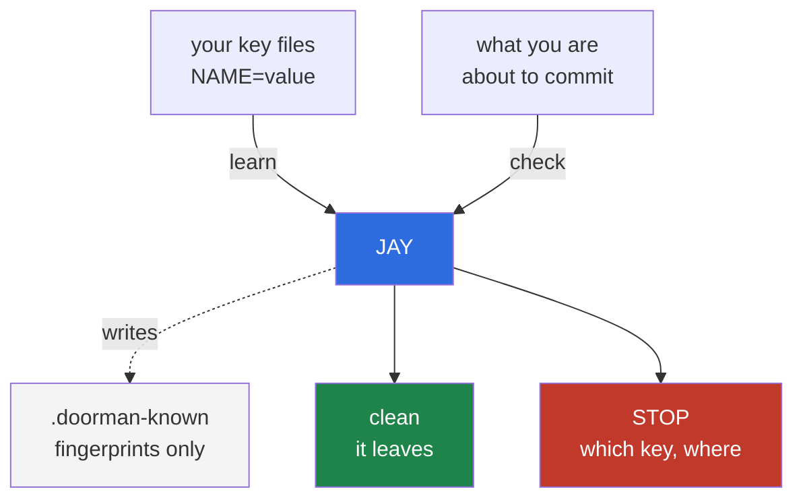

# 👮‍♂️ Doorman Jay

> **A doorman for your git repository: you show him your passwords once, and he stops them leaving by accident.**

Jay learns your real credentials — the passwords and access keys your programs
need — and keeps a **fingerprint** of each one: a short code made from the value,
which cannot be turned back into the value. Then, every time you save work to
your project's history, he compares what is about to leave against those
fingerprints. If one of your keys is in there, he stops and tells you which one
and where. **He does not guess, he does not print your key, and he knows nothing
you did not show him.**

---

## 🖼️ How it works



**In words:** you point Jay at the files that hold your keys, he writes down a
fingerprint of each value, and from then on he checks every outgoing change
against that list. Clean goes through; a match stops.

## 😫 The problem

Credentials get copied around by ordinary work. A key ends up in a log, a note,
a transcript — **nobody decided to put it there.** Then one commit, one backup,
one shared folder, and it is out. Being listed in `.gitignore` protects you from
`git`, and from nothing else.

The usual fix is a guard that looks for **things shaped like** a key: long,
random-looking strings. **That guard cries wolf**, and a guard you ignore
protects nothing.

📊 **One measurement, on one machine, not a promise:** over our real folders, the
shape-guessing guard we used before gave **fourteen warnings, nine of them
false.** Jay, over **1,210 real files, gave zero false alarms** — because he only
reports a value he was shown.

## ▶️ Install and run it

**Python 3.11 or newer. Standard library only, one file.** Run on Windows;
not yet run on Linux or macOS.

**Prove it works on your machine first.** It builds its own test files in a
temporary folder, checks itself, and cleans up:

```
python doorman_jay.py --selftest
```

When it passes, the last line is exactly:

```
117 checks, 0 failed
```

**Then, in the repository you want guarded:**

**1.** Create `doorman.toml` at the root:

```toml
key_files    = [".env"]
# key_files  = ["C:/secrets/keys.env"]
suspect      = false
config_names = ["SUPPORT_EMAIL", "PUBLIC_SITE_URL"]
# expect     = 14
```

**2.** Register your keys:

```
python doorman_jay.py learn
```

**3.** Install the hooks — the small programs git runs before it saves or sends:

```
python install.py
```

## 🧰 How to use it

**Registering, and what Jay says about doubtful lines.** He registers every
non-empty value you declared, and names anything that looks unfilled:

```
$ python doorman_jay.py learn
doubtful value: C:\project\.env (API_KEY)
doubtful value: C:\project\.env (SECRET)
learned 4 key(s): API_KEY, REAL_ONE, SECRET, TINY
registry written to C:\project\.doorman-known (fingerprints only)
```

**Checking a file before it goes anywhere.** A finding says where, which name,
and how long — **never the value:**

```
$ python doorman_jay.py check notes.txt
FOUND    C:\project\notes.txt:1  registered key REAL_ONE (24 characters)
doorman_jay: 1 finding(s). A credential would leave this machine. Exit 1.
```

**A clean file:**

```
$ python doorman_jay.py check ok.txt
doorman_jay: clean. Nothing found, and everything was read. Exit 0.
```

### The commands

| | |
|---|---|
| `learn` | write the registry; print how many keys and their names |
| `check PATH...` | walk those paths and report matches |
| `pre-commit` | check what you are about to save |
| `pre-push` | check each commit you are about to send |
| `ack PATH...` | record that a person accepts these items as unread |
| `ack --all-unread` | accept everything the last `check` could not read |
| `--selftest` | build test files in a temp folder and prove the behaviour |

Every command takes `--repo DIR`.

### What the exit code means

A program ends with a number. His are:

| | |
|---|---|
| `0` | nothing found, **and everything was read** |
| `1` | a registered key was found |
| `2` | the guard could not run, and it says why |
| `3` | nothing found, **but something could not be read** — not a clean result |

🔑 **Exit 3 exists on purpose.** *It is not the same to have looked and found
nothing as to have never looked.* A guard that prints "clean" after skipping a
file nobody could decode would tell you a drawer is safe on the strength of
files nobody opened.

## 📏 Limits and scope

| | Does it? | |
|---|---|---|
| Stop a key you registered, written plainly | ✅ | in a commit, a push, or any file you check |
| Stop a key it was never shown | ❌ | show it to him: he knows nothing else |
| Stop a key that is split, escaped, reversed or encoded | ❌ | that is smuggling, not an accident; a git hook was never the defence |
| Guard a repository with no `doorman.toml` | ❌ | the hooks let it through and print that they checked nothing |
| Print your credential anywhere | ❌ | by design — never one character |
| Say so when something could not be read | ✅ | exit 3, and `ack` to accept it on the record |
| Defend against someone attacking you | ❌ | if they already run code on your machine, he is not in their way |
| Guess at keys by their shape | ❌ by default | `suspect = true` turns it on, and you accept false alarms |
| Run on Linux or macOS | ⚠️ not yet run there | the code avoids system-specific guesses, but a claim is only true where it has been run |

🔴 **This section is not an apology. It is the most useful part of the page.**
A tool that names its edges can be trusted inside them.

**Not covered by the self-test, so judge it rather than trust it:** the
machine-wide install and its removal, because they write into a live hooks
folder · the push path without configuration, which is proven through simulated
input and not a real `git push` · a true Windows symlink, which needs a
privilege the self-test does not request.

**He stops accidents, not smuggling.** An accident is always written plainly.
Nobody encodes their own key by mistake — and catching an encoded key would mean
**guessing**, which is exactly how the guard before him produced nine false
alarms.

## 🏠 Shape it to your house

**This was built for one small setup, on purpose: your own projects, your own
machine, your own keys.**

> **"We are asking for a small padlock on the door. If somebody comes from
> outside and knocks the door down, that is something else. That is another
> tool."**
>
> **"This is a key scanner, nothing more. It is not a bazooka, and it is not a
> guard post with armed guards. It is not a security tool, if that is what you
> are thinking. It is a scanner so your little keys do not get out. That's all."**

**It is built for people who build small systems for themselves** — their own
home, their own notes, their own companions' memory. **It is not for a product
going out to the public**, or for anything that has to survive someone trying to
break it. If you need an audited scanner across many repositories and many
contributors, use a product built for that.

🔑 **So the question that decides every future feature is: does this stop a key
of mine from getting out?** If instead it defends against someone replacing,
deleting or forging a key, **that belongs in another tool.**

**What is meant to be changed, and where it lives — all of it in `doorman.toml`
at the root of each repository:**

| | |
|---|---|
| `key_files` | which files hold your keys. One, or fifty, inside the repo or outside |
| `config_names` | entries that are **not** secrets, forgiven **by name** — a support address, a public URL |
| `suspect` | `true` adds shape-guessing, and the false alarms that come with it |
| `expect` | a headcount: `learn` refuses if it registers a different number |

**Two thresholds live in `doorman_jay.py`, near the top:** `MIN_LEN` (12), below
which a registered value is reported as short, and `SEARCH_MIN` (8), below which
a value is registered but **not searched for** — because a one-character value
would match almost every line.

### Why the config is per repository, and not once for your whole machine

**What differs between projects is not where the keys are. It is what to
forgive.** One project's `.env` holds a public support address beside its real
secrets; another has no keys at all. **A single machine-wide setting would have
one answer for all of them**, and a guard that cries wolf in one repository is a
guard you switch off for every repository.

Git can be told to use one hooks folder for every repository, and the installer
will print that line for you (`--machine-wide`). **But installing the hooks once
does not protect your repositories** — it only puts the guard in the doorway.
Each repository still needs its own `doorman.toml` and its own `learn`.

**To see where you stand in a repository**, run `python door_watch.py --repo DIR`.
It reports whether the hooks are installed there and whether a fake key is
actually stopped — **and it says so plainly when it cannot tell.**

## 🧷 What a key file looks like, and how to find yours

**Lines of `NAME=value`.** A `.env`, or anything shaped like one.

🔴 **Point `key_files` at files that really hold values.** A guard that knows
nothing reports clean — **which is worse than no guard, because now you trust
it.** Three situations that look fine and are not:

| | |
|---|---|
| A file of stand-ins only | every line is `API_KEY=your_api_key_here`. Jay registers them and **names each one doubtful**, so the file cannot look healthy |
| Keys that live only in environment variables | in no file at all. Write them into a key file, or he cannot know them |
| An inventory written in prose | useful to you, unreadable to a program |

**To find yours, search by name, not by value.** Look for the files (`.env`,
`*.env`, `credentials.json`, `token.json`, `*.key`), then search your configs for
`API_KEY`, `TOKEN`, `SECRET`, and list the environment variables whose names
contain them. **You do not need to read a single secret to build this list, and
you should not paste one into a terminal, a chat, or an agent's context.**

### Two habits of ours — offered, not required

**Neither is needed for Jay to work.**

**We keep the values outside every repository.** A credential inside a project
folder is one backup, one copied folder away from leaving. *If you move them,
make each program **stop and say so** when the file is missing — starting without
its keys fails later, somewhere else, confusingly.*

**We keep an inventory, and we know it is not the source.** A list of which key
is which, when it was rotated, which are revoked — worth having. **But a
hand-written label is not proof. The live value is what the program reads, and
when they disagree the program wins.**

## 🙊 Two things he refuses to do

**He never prints a credential.** Not one character. A finding prints **where**
it is, **which registered name** it is, and **how long** it is. Paths and branch
names pass through redaction first, so a file named after a key is not echoed
either. *A guard that prints the key puts the key in the log.*

**He never calls a file he could not read "clean".** A PDF, a database or an
image **can** hold a credential. He says it was not read — that is exit 3 — and
you can accept an item once, on the record, with `ack`. That record is bound to
**both the path and the content**: if the bytes change later, the item is
reported again. Acknowledgements apply to `check` only. **A binary being
committed right now is an event, not scenery.**

## 🙏 Credits

The name is hers: **Jaime el Portero**. Readers who found real defects in the
published tool are named with what they found, including **Chadrien Solance**,
whose questions uncovered two.

Full list: [CREDITS.md](CREDITS.md)

## 📄 Licence

**MPL-2.0.** See [LICENSE](LICENSE).
